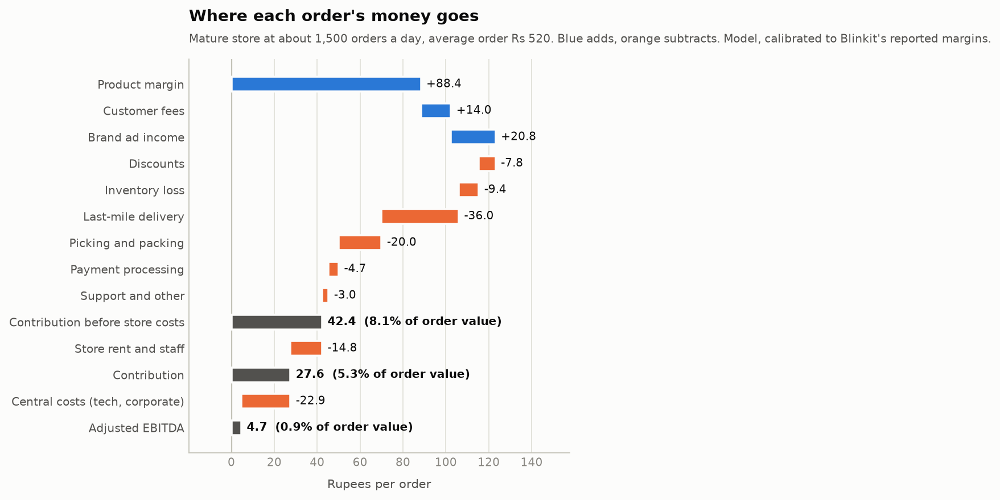
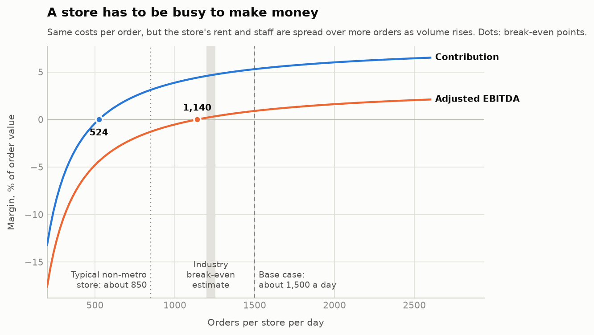
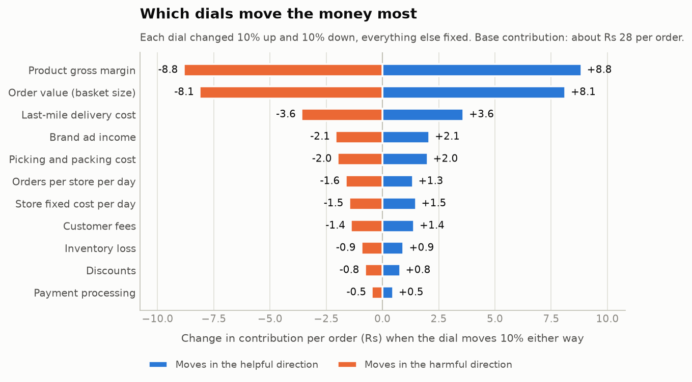
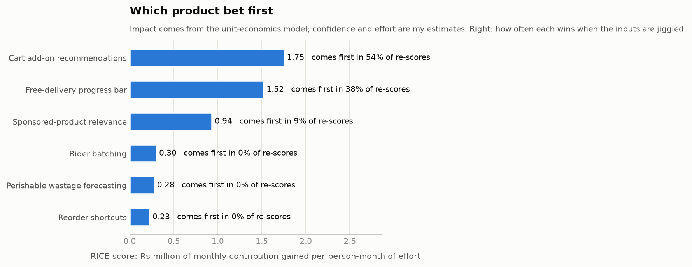
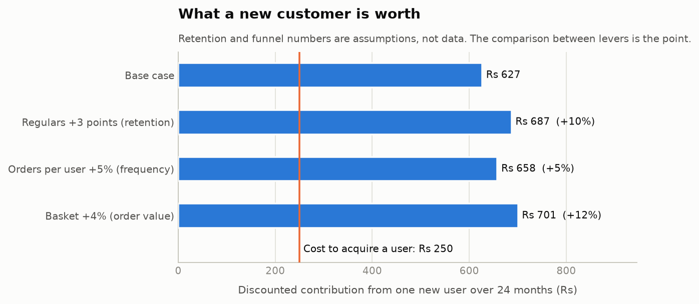

# Quick-commerce unit economics and a product bet: what should the next product team build?

A 10-minute delivery app makes about Rs 28 on a Rs 520 order. This project builds a **unit-economics model** of one dark store,
finds **which levers move that money**, uses the model to **score six product bets (RICE)**, picks one, and writes the
**PRD and A/B test plan** for it. It also covers the **funnel and customer lifetime value**.

> **Read this first: what is real and what is assumed.**
> Companies publish only totals (Blinkit: contribution margin 5.3%, adjusted EBITDA 0.9%, Q2 FY27). **Nobody publishes the cost of one delivery or one
> picker.** So the individual cost lines here are *my assumptions*, tuned so the totals match the reported margins. Average order value and orders per store
> come from secondary sources and are approximate. Funnel rates, retention, bet effects, confidence and effort are assumptions too.
> Every input is tagged **D** (disclosed, with source), **C** (calibrated) or **A** (assumption) in `results/inputs.csv`.
> The model shows how levers *compare*; it does not claim to know any company's true costs. No internal company data was used.

## The business question

*Where does the money per order come from and go, how many orders a store needs to pay for itself, and which product change would add the most for the effort?*

## What it does

1. **Unit-economics waterfall** (`src/economics.py`): product margin, fees, ad income, discounts, inventory loss, delivery, picking and packing, payment, support,
   then the store's fixed cost spread over its orders, then central costs. Calibrated to the reported 5.3% and 0.9%.
2. **Order density and break-even**: a store's rent and staff are fixed, so orders per store per day is the master variable.
3. **Tornado**: move each dial by 10% and see which matters.
4. **Funnel and lifetime value** (`src/retention.py`): conversion by step, what one extra point at each step is worth, a retention curve and value per new customer against acquisition cost.
5. **RICE** (`src/rice.py`): six bets, with **Impact computed from the model** instead of guessed, and a stability check that re-scores 5,000 times with the judgement inputs jiggled.
6. **PRD, A/B test plan, metrics tree** (`docs/`), generated from the model's numbers so they cannot drift from the analysis.
7. **Test-design maths** (`src/abtest.py`): sample size, minimum detectable effect, duration, variance reduction, and a simulation that checks the formulas.

## Results

(Base case: Rs 520 order, 1,500 orders per store per day. Full text in `results/findings.md`.)

**1. Thin money per order.** Rs 42.4 before store costs, **Rs 27.6 contribution (5.3%)** after rent and staff, Rs 4.7 (0.9%) after central costs.


**2. Density decides profitability.** The store costs about Rs 22,200 a day. Contribution breaks even at 524 orders a day; adjusted EBITDA at **1,140**
(Redseer's industry estimate for mature metro stores: 1,200-1,250; it does not state the margin level, so I compare with the EBITDA figure). Non-metro stores at about 850 orders sit between the two.


**3. Product margin and basket size dominate.** A 10% change moves contribution by Rs 8.8 (product margin) and Rs 8.1 (basket size); the next, delivery cost, is Rs 3.6.
Product margin is mostly category mix, which a product team moves slowly. Basket size is what a product team can test.


**4. The bet: cart add-on recommendations.** Ranked first by RICE (1.75 M Rs of monthly contribution per person-month in a 100-store city). It is **not a runaway winner**:
it comes first in 54% of 5,000 jiggled re-scores, the free-delivery progress bar in 38%, sponsored-product relevance in 9%; the other three never. The top two are close and share a screen, so the plan suggests testing them together.


**5. Customer value (assumed curve).** A new customer is worth about Rs 627 over 24 months against Rs 250 acquisition cost (2.5x). A 4% bigger basket adds 12%; three more points of long-run regulars add 10%.


**6. The test.** To see a 2% basket lift: about 24,300 orders per arm after variance reduction, which a 100-store city collects in 3 days, so the two-week minimum sets the length.
A simulation with skewed (log-normal) basket values gives a 4.9% false-positive rate and 79% power against the 5% and 80% targets.

## Documents

| File | What it is |
|---|---|
| `docs/PRD.md` | Product requirements for the add-on row: problem, evidence, solution, requirements, metrics, alternatives, risks, rollout |
| `docs/AB_TEST_PLAN.md` | Design, sample size, guardrails, analysis plan written before the test, threats to validity |
| `docs/METRICS_TREE.md` | How contribution decomposes into orders, basket and cost; funnel; what a funnel point is worth |

## How the main choices were made

- **Calibrate to the totals, label the lines.** Since cost lines are not public, the store fixed cost and central cost are *derived* so the model reproduces 5.3% and 0.9%. Everything else is an assumption you can change in `src/inputs.py`.
- **Impact comes from the model.** A bet's value per order is the change in modelled contribution, so a bet that cuts delivery cost and a bet that grows baskets are scored in the same rupees.
- **Judgement is shown as judgement.** Confidence and effort are my estimates; the stability check shows how much the ranking depends on them.
- **Levers touch only part of the orders** (reach), so a big effect on few orders is not confused with a small effect on all.
- **Randomise by user, not by order**, and inflate the sample for repeat orders from the same user.

## Honest limitations

- **The cost split is not measured.** Only the totals are anchored. A different split with the same totals would change the tornado ranking somewhat.
- **AOV and orders per store are approximate**, from secondary sources (I could not open the company's own letter).
- **Redseer's break-even** has no stated margin level; comparing it with EBITDA break-even is my reading.
- **Bet effects (+4% basket and so on) are hypotheses**, not data. The A/B test exists to measure them.
- **Retention and funnel are assumed.** No public cohort data exists for Indian quick commerce.
- **RICE is a prioritisation aid, not a forecast.** The top two bets are close.
- **No customer research or real cart data.** The PRD lists what I would check first.

## Run it

```bash
pip install -r requirements.txt
python run_analysis.py        # writes results/ and docs/
python -m pytest -q           # 19 tests
```

## Project layout

```
run_analysis.py      runs everything
src/inputs.py        every input, tagged D / C / A with source
src/economics.py     waterfall, calibration, break-even, tornado, bet definitions
src/retention.py     funnel, retention curve, lifetime value
src/rice.py          RICE table and rank stability
src/abtest.py        sample size, MDE, duration, power simulation
src/report.py        charts          src/docs.py   PRD, test plan, metrics tree
tests/               19 tests (calibration, waterfall, break-even, hand-checked basket lever, textbook sample sizes, simulation)
results/  docs/      outputs of the latest run
```
